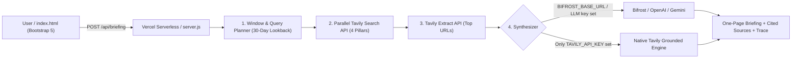

# BriefPulse — Autonomous Pre-Meeting Research Agent

**Hackathon Theme:** Tavily Research Agent (*AI Agents & Intelligent Systems*)  
**Stack:** Bootstrap 5.3 + Vanilla JS (`index.html`), Node.js Serverless AI Agent (`api/` & `lib/agent.js`), Tavily Search & Extract APIs, optional Bifrost / OpenAI / Gemini LLM Gateway, Vercel-ready.

BriefPulse is an autonomous pre-meeting intelligence agent that prepares a concise, source-backed **one-page executive briefing** before any scheduled meeting. Given a company or person, a scheduled meeting date/time, and optional context, the agent researches the **preceding 30 days** of live developments—news, product launches, executive hires, and strategic market signals—and produces verified findings with clickable citations, tailored discussion points, and open questions.

---

## Key Capabilities

1. **Exact 30-Day Pre-Meeting Windowing**
   - Automatically calculates the 30-day lookback window `[meetingDate - 30d, min(meetingDate, today)]` and passes `start_date` and `end_date` directly to Tavily Search.
2. **4-Pillar Autonomous Research Agent (`lib/agent.js`)**
   - **Stage 1 — Query Planner:** Auto-detects `Company` vs `Person` (or uses explicit selection) and generates 4 targeted queries across **News**, **Product Launches**, **Leadership & Hires**, and **Market/Partnership Signals**.
   - **Stage 2 — Parallel Tavily Search:** Executes all 4 searches concurrently using `POST https://api.tavily.com/search` (`topic: "news"` / `"general"`, `include_answer: true`, `search_depth: "advanced"`), then canonicalizes and deduplicates URLs.
   - **Stage 3 — Tavily Deep Extract:** Pulls clean full-article markdown from the top-ranked URLs using `POST https://api.tavily.com/extract` for deeper fact grounding.
   - **Stage 4 — Grounded Briefing Synthesizer:**
     - **Works 100% with ONLY `TAVILY_API_KEY`:** Uses the built-in **Native Tavily Grounded Synthesis Engine** to classify findings, extract evidence sentences, and generate context-aware discussion points and open questions.
     - **Optional LLM Upgrade (Bifrost / OpenAI / Gemini):** Automatically routes synthesis through **Bifrost Gateway** (`BIFROST_BASE_URL`), OpenAI, or Gemini when configured in `.env`.
3. **One-Page Executive UI (`index.html` + Bootstrap 5.3)**
   - Opens directly in any browser (`file://`) with built-in interactive sample briefings and optional session-key live testing.
   - Live **Agent Execution Trace** timeline showing latency and per-stage status.
   - Category filtering (`All`, `News`, `Launches`, `Hires`, `Signals`), clickable `[1]` citation pills, Dark/Light theme toggle, **Markdown copy/download**, and **Print / Save as PDF** (`@media print` one-page layout).

---

## Architecture



---

## Project Structure

```text
.
├── public/
│   ├── index.html          # Main Bootstrap 5.3 UI (opens directly or served via Node/Vercel)
│   └── assets/
│       ├── css/styles.css  # Editorial styles, trace timeline, and @media print 1-page PDF layout
│       └── js/app.js       # Client controller, sample briefings, Markdown export, safe DOM rendering
├── api/
│   ├── briefing.js         # Vercel Serverless Function: POST /api/briefing
│   └── health.js           # Vercel Serverless Function: GET /api/health
├── lib/
│   └── agent.js            # Core 4-stage Tavily Research Agent & synthesis engine
├── server.js               # Zero-dependency local Node.js server with built-in .env loader
├── vercel.json             # Vercel routing & 60s function timeout config
├── package.json            # Node >=18 metadata & start scripts
├── .env.example            # Environment variable template
└── PITCH_DECK.md           # Hackathon pitch deck outline
```

---

## Installation & Local Setup

### Prerequisites
- **Node.js 18+** (for running the backend locally or deploying with Vercel CLI; zero external npm packages required!)
- A **Tavily API Key** from [app.tavily.com](https://app.tavily.com)

### 1. Configure `.env`
Copy `.env.example` to `.env` and add your Tavily API key:

```bash
cp .env.example .env
```

Edit `.env`:
```env
TAVILY_API_KEY=tvly-your-api-key-here
```

*(Optional)* To also route final synthesis through **Bifrost by Maxim AI** (or OpenAI/Gemini):
```env
BIFROST_BASE_URL=http://localhost:8080/v1
BIFROST_MODEL=openai/gpt-4o-mini
```

### 2. Run Locally (Zero `npm install` Needed)
```bash
node server.js
```
Then open [http://localhost:3000](http://localhost:3000).

> **Quick Static Preview:** You can also open `public/index.html` directly in your browser to explore the Bootstrap 5 UI, sample briefings, Print/PDF layout, and optional session-key test mode.

---

## Deploying to Vercel

1. Push this repository to a public GitHub repo (or deploy directly with Vercel CLI):
   ```bash
   npx vercel
   ```
2. In your **Vercel Project Settings → Environment Variables**, add:
   - `TAVILY_API_KEY` = `tvly-...`
   - *(Optional)* `BIFROST_BASE_URL`, `BIFROST_API_KEY`, `BIFROST_MODEL`, `OPENAI_API_KEY`, or `GEMINI_API_KEY`
3. Deploy! Vercel automatically serves `public/index.html` at `/` and deploys `api/briefing.js` and `api/health.js` as serverless functions.

---

## API Reference

### `GET /api/health`
Returns runtime status and whether `TAVILY_API_KEY` and an optional LLM gateway are configured (without exposing secrets).

### `POST /api/briefing`
Request body:
```json
{
  "target": "Stripe",
  "entityType": "auto",
  "meetingDateTime": "2026-11-15T10:00:00.000Z",
  "meetingContext": "Enterprise billing & AI metering partnership",
  "depth": "deep"
}
```
Response includes `meta` (computed 30-day window & latency), `trace` (4-stage execution log), `briefing` (`executiveSummary`, `findings`, `discussionPoints`, `openQuestions`), and `sources` (deduplicated numbered citations).

---

## Technologies Used
- **Tavily Search API** (`POST /search` with `start_date`, `end_date`, `topic`, `search_depth`, `include_answer`)
- **Tavily Extract API** (`POST /extract` for full-article markdown verification)
- **Optional Bifrost AI Gateway** (OpenAI-compatible `/chat/completions` routing)
- **Bootstrap 5.3 & Bootstrap Icons** (responsive accessible UI + print-to-PDF executive stylesheet)
- **Node.js 18+ & Vercel Serverless Functions** (zero-dependency backend)

